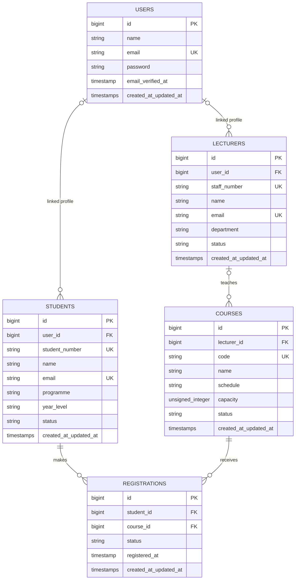

# Database Design

## Scope and assumptions

This design reflects the current student-management features: account and role
management, student and lecturer profiles, a course catalogue, and student
registrations. Laravel authentication, sessions, cache, queues, passkeys, and
API tokens remain in their framework-managed tables.

The business schema below matches the current migrations. Recommendations for
academic terms and data retention are called out separately so they are not
mistaken for features already implemented.

## Entity relationship diagram

`UK` denotes a unique constraint. `FK` denotes a foreign key. `timestamps`
means Laravel's `created_at` and `updated_at` columns.

## Tables and responsibilities

| Table | Responsibility | Important constraints |
|---|---|---|
| `users` | Login identity. Roles are assigned through Spatie Laravel Permission. | Unique email. Admins do not need a student or lecturer profile. |
| `roles`, `permissions`, and their pivots | Spatie role definitions, user-role assignments, and role-permission grants. | Role names are `student`, `lecturer`, and `admin`; `model_has_roles` links roles to users and `role_has_permissions` links permissions to roles. |
| `students` | Student number and academic profile. | Unique student number and profile email; optional user link. |
| `lecturers` | Staff number and lecturer profile. | Unique staff number and profile email; optional user link. |
| `courses` | Course catalogue, lecturer assignment, schedule, capacity, and availability. | Unique course code; lecturer assignment is optional. |
| `registrations` | Student-to-course enrolment and its status/timestamp. | Unique `(student_id, course_id)` prevents duplicate enrolment in the same course. |

Primary keys are Laravel-generated unsigned big integers. Foreign keys are
indexed by Laravel. The registration pair has a composite unique index, which
also supports lookups by student followed by course. Add a separate
`(course_id, student_id)` index if course roster queries become frequent and
the database does not provide an efficient plan for them.

## Relationships and delete behavior

- Profile-to-user links are optional. The current schema does not enforce a
  one-profile-per-user rule because `students.user_id` and `lecturers.user_id`
  are nullable and not unique. Add unique constraints if one-to-one profile
  ownership is required.
- A lecturer may teach multiple courses; each course has zero or one lecturer.
- Students and courses have a many-to-many relationship through
  `registrations`.
- Deleting a user preserves their profile by setting the profile's `user_id`
  to `NULL`. Deleting a lecturer preserves their courses by setting
  `lecturer_id` to `NULL`.
- Deleting a student or course currently cascades to its registrations. This
  removes enrolment history. Prefer deactivation/soft deletion or a restrictive
  delete policy if historical records must be retained.

## Data integrity and application rules

1. Keep Spatie role assignment restricted to trusted administration; public
   sign-up should not accept a privileged role.
2. Validate status values in the application. Suggested sets are student and
   lecturer: `active`, `on_leave`, `inactive`; course: `open`, `closed`; and
   registration: `pending`, `confirmed`, `waitlisted`, `dropped`.
3. Ensure course capacity is positive. Enforce the capacity limit in a
   transaction that locks the course row while counting confirmed
   registrations; a simple validation before insert can overbook under
   concurrent requests.
4. Treat `registered_at` as the time the registration is created or confirmed,
   and define that choice consistently. Keep registration status changes on
   the registration row rather than creating duplicate rows.
5. Student and lecturer profile `name` and `email` duplicate the account
   identity fields. Keep them synchronized if they represent the same
   institutional identity. If profile contact details are intentionally
   independent, label and validate them as such.

## Known limitation and evolution path

The current unique `(student_id, course_id)` rule only allows a student to
register for a course once, ever. If courses repeat by semester or academic
year, introduce:

- `academic_terms(id, name, starts_on, ends_on, status)`;
- `course_offerings(id, course_id, term_id, lecturer_id, section, schedule,
  capacity, status)`, unique on `(course_id, term_id, section)`;
- change `registrations` to reference `course_offering_id`, unique on
  `(student_id, course_offering_id)`.

This separates the permanent course catalogue from term-specific teaching,
capacity, schedule, and lecturer assignment, while retaining a normalized
registration history. Add grade/assessment tables only when grading is in
scope.

## Implementation note

The currently implemented schema is defined in
`database/migrations/2026_11_03_000000_create_academic_management_tables.php`.
User role assignments use Spatie Laravel Permission tables. The migration
`database/migrations/2026_11_07_140404_migrate_user_roles_to_spatie_permission_roles.php`
transfers existing `users.role` values to Spatie before removing the legacy
column. Apply schema changes through new Laravel migrations so existing data
is preserved.
